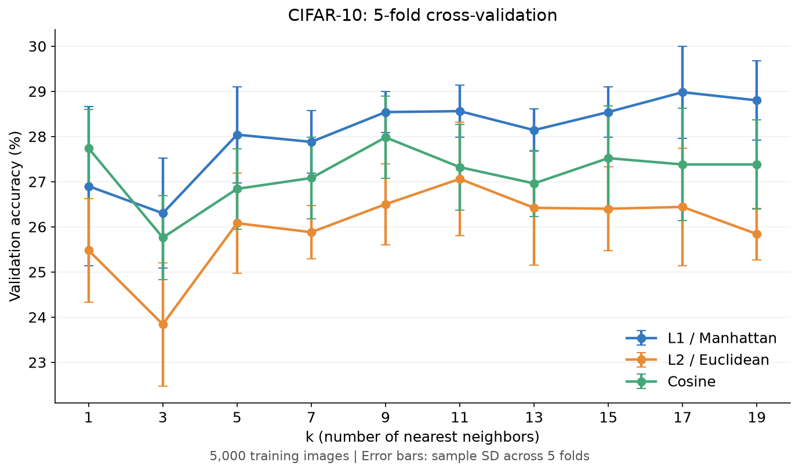

# CIFAR-10 KNN

Classify CIFAR-10 images with KNN, compare distance metrics and k values using 5-fold cross-validation, then test the selected setting.

KNN으로 CIFAR-10 이미지를 분류합니다. 5-fold 교차검증으로 거리 함수와 k를 비교한 뒤 선택한 설정을 테스트합니다.

## Algorithm Flow / 알고리즘 흐름

1. **Load and sample / 데이터 준비:** Select 5,000 training and 1,000 test images with balanced class proportions; use seed 42. / 클래스 비율을 유지해 학습 5,000장·테스트 1,000장을 선택하며 seed는 42입니다.
2. **Preprocess / 전처리:** Each 32×32 RGB image has 3,072 values, already flattened as [1,024 R, 1,024 G, 1,024 B values]. Flattening rearranges existing values without adding features; 5,000 images form a (5000, 3072) array. Divide values by 255; KNN compares matching positions in these vectors. / 이미지 한 장은 32×32×3 = 3,072개 값이며, 파일에 이미 [R 1,024개, G 1,024개, B 1,024개] 순서로 펼쳐져 있습니다. 펼치기는 새 특징을 만드는 것이 아니라 기존 값을 한 줄로 배치하는 것입니다. 학습 5,000장의 배열 크기는 (5000, 3072)이고, 값을 255로 나눈 뒤 KNN에서 벡터의 같은 위치끼리 비교합니다.
3. **Train / 학습:** Store training images and labels. / 학습 이미지와 정답을 저장합니다.
4. **Predict / 예측:** Compute distances, select the nearest k images and predict by majority vote. Voting ties select the smaller class ID. / 거리를 계산해 가까운 k개 이미지를 선택하고 다수결로 예측합니다. 투표 동률이면 작은 클래스 ID를 선택합니다.
5. **Validate / 검증:** Compare L1 (Manhattan), L2 (Euclidean) and cosine with k=1, 3, 5, 7, 9, 11, 13, 15, 17, 19. Each fold uses 4,000 training and 1,000 validation images. Select the highest mean validation accuracy across five folds. / L1·L2·Cosine과 k=1, 3, 5, 7, 9, 11, 13, 15, 17, 19를 비교합니다. Fold마다 학습 4,000장·검증 1,000장을 사용하고 다섯 fold의 평균 정확도로 설정을 선택합니다.
6. **Test / 테스트:** Use all 5,000 training images with the selected setting and evaluate the separate 1,000-image test subset. / 선택한 설정으로 학습 5,000장을 모두 사용해 별도 테스트 표본 1,000장을 평가합니다.

Code / 코드: [assignment4.py](assignment4.py)

## Results / 실행 결과

### Cross-validation / 교차검증

Mean validation accuracy across five folds (%).

다섯 fold의 평균 검증 정확도(%)입니다.

| k | L1 (Manhattan) | L2 (Euclidean) | Cosine |
|---:|---:|---:|---:|
| 1 | 26.90 | 25.48 | 27.74 |
| 3 | 26.30 | 23.84 | 25.76 |
| 5 | 28.04 | 26.08 | 26.84 |
| 7 | 27.88 | 25.88 | 27.08 |
| 9 | 28.54 | 26.50 | 27.98 |
| 11 | 28.56 | 27.06 | 27.32 |
| 13 | 28.14 | 26.42 | 26.96 |
| 15 | 28.54 | 26.40 | 27.52 |
| 17 | 28.98 | 26.44 | 27.38 |
| 19 | 28.80 | 25.84 | 27.38 |



**L1, k=17** achieved the highest mean validation accuracy of **28.98%**. The best k values were 17 for L1, 11 for L2, and 9 for cosine.

**L1, k=17**의 평균 검증 정확도가 **28.98%**로 가장 높았습니다. 거리별 평균 정확도는 L1에서 k=17, L2에서 k=11, Cosine에서 k=9일 때 가장 높았습니다.

### Test / 테스트

The selected setting correctly classified 313 of 1,000 separate test images.

선택한 설정으로 별도 테스트 이미지 1,000장 중 313장을 맞혔습니다.


| Setting or metric / 조건 및 지표 | Result / 결과 |
|---|---:|
| Selected setting / 선택한 설정 | L1 (Manhattan), k=17 |
| Mean CV accuracy / 평균 검증 정확도 | 28.98% |
| Test accuracy / 테스트 정확도 | 31.30% |
| Macro precision | 39.29% |
| Macro recall | 31.30% |
| Macro F1 | 29.33% |

These are single-seed results on a CIFAR-10 subset, not the full dataset. Macro metrics average scores across the ten classes. Detailed CSV and JSON records are saved in [results](results).

전체 CIFAR-10이 아닌 부분집합의 단일 seed 결과입니다. Macro 지표는 열 개 클래스의 점수를 평균한 값입니다. 상세 CSV·JSON 기록은 [results](results)에 보관했습니다.

## Data and Run / 데이터 준비 및 실행

From the repository root, install dependencies and download the **CIFAR-10 python version** from the [official page](https://www.cs.toronto.edu/~kriz/cifar.html). The dataset is excluded from the repository. On macOS/Linux:

저장소 루트에서 의존성을 설치하고 [공식 페이지](https://www.cs.toronto.edu/~kriz/cifar.html)의 **CIFAR-10 python version**을 받습니다. 원본 데이터는 저장소에 포함하지 않았습니다. macOS/Linux에서는 다음 명령을 사용합니다.

```bash
python -m pip install -r KNN/requirements.txt
curl -fL https://www.cs.toronto.edu/~kriz/cifar-10-python.tar.gz -o KNN/cifar-10-python.tar.gz
tar -xzf KNN/cifar-10-python.tar.gz -C KNN
python KNN/assignment4.py
```

Place `data_batch_1`–`data_batch_5`, `test_batch` and `batches.meta` inside `KNN/cifar-10-batches-py/`. Running the script overwrites numerical results; plots and Markdown reports are maintained separately. The [synthetic 2D example](results/knn_2d.png) shows L1 and L2 decision boundaries for k=9, 11, 13, 15, 17, and 19.

`KNN/cifar-10-batches-py/` 안에 `data_batch_1`–`data_batch_5`, `test_batch`, `batches.meta`가 있어야 합니다. 실행하면 수치 결과를 덮어쓰며 그래프와 Markdown 보고서는 별도로 관리합니다. [2D 가상 예시](results/knn_2d.png)에서는 k=9, 11, 13, 15, 17, 19의 L1과 L2 결정 경계를 비교합니다.
