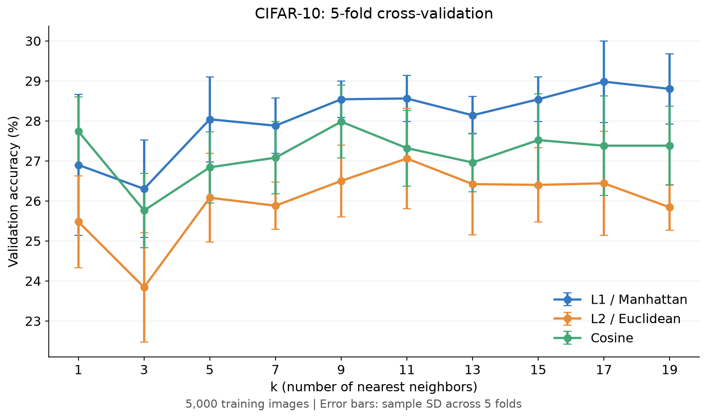

# CIFAR-10 KNN Results / 실험 결과

## Setup / 실험 조건

- **Data / 데이터:** 5,000 training and 1,000 test images, sampled with balanced class proportions. / 클래스 비율을 유지한 학습 5,000장·테스트 1,000장.
- **Input / 입력:** Raw RGB pixels flattened to 3,072 features and divided by 255. / 원시 RGB 픽셀을 3,072차원으로 펼친 뒤 255로 나눔.
- **Seed:** 42.
- **Comparison / 비교:** L1, L2, cosine; k=1, 3, 5, 7, 9, 11, 13, 15, 17, 19.
- **Validation / 검증:** Five folds, each with 4,000 training and 1,000 validation images. / 5-fold, 매번 학습 4,000장·검증 1,000장.

## Cross-validation Results / 교차검증 결과

Mean validation accuracy across five folds (%). Detailed fold results: [cv_folds.csv](details/cv_folds.csv).

다섯 fold의 평균 검증 정확도(%)입니다. Fold별 결과: [cv_folds.csv](details/cv_folds.csv).

| k | L1 (Manhattan) | L2 (Euclidean) | Cosine |
|---:|---:|---:|---:|
| 1 | 26.90 | 25.48 | 27.74 |
| 3 | 26.30 | 23.84 | 25.76 |
| 5 | 28.04 | 26.08 | 26.84 |
| 7 | 27.88 | 25.88 | 27.08 |
| 9 | 28.54 | 26.50 | 27.98 |
| 11 | 28.56 | 27.06 | 27.32 |
| 13 | 28.14 | 26.42 | 26.96 |
| 15 | 28.54 | 26.40 | 27.52 |
| 17 | 28.98 | 26.44 | 27.38 |
| 19 | 28.80 | 25.84 | 27.38 |

**L1, k=17** achieved the highest mean validation accuracy of **28.98%**. The best k values were 17 for L1, 11 for L2, and 9 for cosine.

**L1, k=17**의 평균 검증 정확도가 **28.98%**로 가장 높았습니다. 거리별 평균 정확도는 L1에서 k=17, L2에서 k=11, Cosine에서 k=9일 때 가장 높았습니다.

## Test Results / 테스트 결과

The selected setting used all 5,000 training images and correctly classified 313 of 1,000 separate test images.

선택한 설정에 학습 5,000장을 모두 사용했으며, 별도 테스트 이미지 1,000장 중 313장을 맞혔습니다.

| Metric / 지표 | Result / 결과 |
|---|---:|
| Accuracy | 31.30% |
| Precision (macro) | 39.29% |
| Recall (macro) | 31.30% |
| F1-score (macro) | 29.33% |

Macro metrics average the scores of the ten classes. The selected setting reflects the candidates tested on this single-seed subset. Raw pixel similarity can also be affected by viewpoint, lighting and background.

Macro 지표는 열 개 클래스의 점수를 평균한 값입니다. 이 결과는 단일 seed로 선택한 부분집합과 비교한 후보에 해당합니다. 원시 픽셀의 유사도는 시점·조명·배경의 영향도 받습니다.

Detailed records / 상세 기록: [settings and scores / 설정·점수](result.json) · [CV summary / 검증 요약](cv_summary.csv) · [per-class scores / 클래스별 지표](details/test_per_class.csv) · [confusion matrix / 혼동행렬](details/confusion_matrix.csv).
