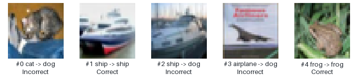
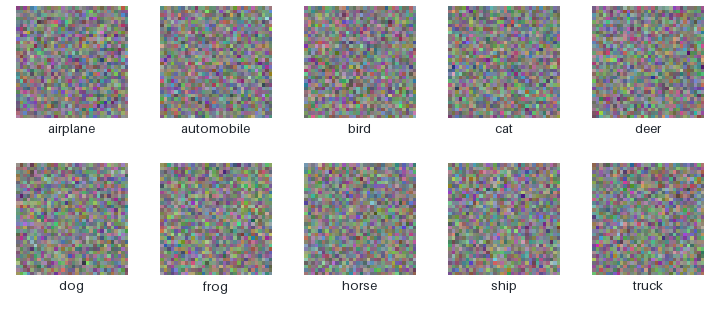

# Linear Classification / 선형 분류

Compute class scores, SVM hinge loss, and Softmax probabilities for five CIFAR-10 images using a linear classifier with fixed random weights.

고정된 무작위 가중치를 사용하는 선형 분류기로 CIFAR-10 예시 5장의 클래스 점수, SVM hinge loss, Softmax 확률을 계산합니다.

## Algorithm Flow / 알고리즘 흐름

1. **Input / 입력.** Use the first five images from the official test batch. Divide each 32×32 RGB image’s 3,072 pixel values by 255. / 공식 테스트 배치의 처음 5장을 사용합니다. 32×32 RGB 이미지 한 장의 픽셀 값 3,072개를 각각 255로 나눕니다.
2. **Initialization / 초기화.** With seed 42, draw `W` of shape `(10, 3072)` from a normal distribution with mean 0 and standard deviation 0.01. Set all 10 entries in `b` to zero. / 시드 42로 평균 0, 표준편차 0.01인 정규분포에서 `W`를 초기화하고 `b`의 10개 값을 0으로 설정합니다.
3. **Scores and prediction / 점수와 예측.** Compute `scores = W @ x + b` and predict the class with the highest score. / `scores = W @ x + b`로 10개 점수를 계산하고 가장 높은 점수의 클래스를 예측합니다.
4. **SVM hinge loss / SVM 손실.** For each wrong class `j`, add `max(0, scores[j] - scores[y] + 1)`, where `y` is the true class. Average the five image losses. / 정답 클래스 `y`를 제외한 각 클래스에 대해 `max(0, scores[j] - scores[y] + 1)`을 더하고, 이미지 5장의 손실을 평균합니다.
5. **Softmax / 소프트맥스.** Subtract the largest score for numerical stability, exponentiate, and divide by the sum. Check that each image’s probabilities sum to 1 and give the same predicted class as the raw scores. / 수치 안정을 위해 최댓값을 뺀 뒤 지수화하고 합으로 나눕니다. 이미지마다 확률 합이 1이고 원래 점수와 예측 클래스가 같은지 확인합니다.

[Python source / 소스 코드](linear_classifier.py)

## Results / 실행 결과



| Test index / 테스트 인덱스 | True class / 정답 | Predicted class / 예측 | Probability sum / 확률 합 | SVM hinge loss |
|---:|---|---|---:|---:|
| 0 | cat | dog | 1.000000 | 14.454526 |
| 1 | ship | ship | 1.000000 | 2.754030 |
| 2 | ship | dog | 1.000000 | 4.067474 |
| 3 | airplane | dog | 1.000000 | 15.235916 |
| 4 | frog | frog | 1.000000 | 3.573214 |

The **mean SVM hinge loss is 8.017032**. Image #1 is correctly predicted as ship, but its loss is positive because some competing scores are within the margin of 1. Image #0 is predicted as dog because the dog score exceeds the true cat score.

**평균 SVM hinge loss는 8.017032**입니다. #1은 ship을 맞혔지만 일부 다른 클래스와의 점수 차가 마진 1보다 작아 손실이 남습니다. #0은 dog 점수가 정답인 cat 점수보다 높아 오분류했습니다.

### Scores and probabilities / 점수와 확률 비교

The table shows all ten scores and probabilities for image #0. Softmax preserves their order. For example, the highest raw score (dog, 0.588500) becomes the highest probability (0.142327). The CSV covers all five images.

아래는 #0의 10개 클래스 점수와 확률입니다. Softmax는 점수 순서를 유지합니다. 예를 들어 가장 높은 dog 점수 0.588500은 가장 높은 확률 0.142327로 변환됩니다. CSV에서 예시 5장의 전체 값을 확인할 수 있습니다.

| Class / 클래스 | Raw score / 원래 점수 | Softmax probability / 확률 |
|---|---:|---:|
| airplane | -0.155977 | 0.067603 |
| automobile | +0.305281 | 0.107223 |
| bird | -0.143712 | 0.068437 |
| cat | -0.360996 | 0.055072 |
| deer | +0.175156 | 0.094140 |
| dog | +0.588500 | 0.142327 |
| frog | +0.553838 | 0.137478 |
| horse | +0.461676 | 0.125374 |
| ship | +0.483354 | 0.128122 |
| truck | -0.062553 | 0.074223 |

[Scores and probabilities for all five images / 5장의 전체 점수·확률 CSV](results/scores_and_probabilities.csv)

### Class weights / 클래스별 가중치



Each row of `W` is restored from CIFAR-10’s channel order to a 32×32 RGB image. All ten images use the same color scale, with zero mapped to midgray. The weights were sampled independently of the images and labels, so the colors resemble noise. A correct prediction here is a chance match between the largest random score and the true label.

`W`의 각 행을 CIFAR-10 채널 순서에 맞춰 32×32 RGB 이미지로 복원했습니다. 10장에 동일한 표시 범위를 사용하고 가중치 0은 중간 회색으로 표시했습니다. 이미지와 정답을 학습하지 않고 독립적으로 뽑은 가중치라 색상이 잡음처럼 보입니다. 정답 사례는 무작위 가중치에서 가장 높은 점수를 받은 클래스가 실제 정답과 우연히 일치한 경우입니다.

## Data and Run / 데이터 준비 및 실행

Download and extract the **CIFAR-10 Python version**. Place `test_batch` and `batches.meta` in `Linear-Classification/cifar-10-batches-py/`, or pass the path to your existing dataset folder as the first argument. Run the commands from the repository root. [CIFAR-10 dataset](https://cave.cs.toronto.edu/kriz/cifar.html)

**CIFAR-10 Python version**의 압축을 풀고 `test_batch`와 `batches.meta`를 `Linear-Classification/cifar-10-batches-py/`에 넣습니다. 기존 데이터 폴더가 있으면 첫 번째 인자로 경로를 전달할 수 있습니다. 아래 명령은 저장소 루트에서 실행합니다. [CIFAR-10 데이터셋](https://cave.cs.toronto.edu/kriz/cifar.html)

```bash
python -m pip install -r Linear-Classification/requirements.txt
python Linear-Classification/linear_classifier.py
```

The script prints the scores and losses and recreates the CSV and both PNGs in `results/`. / 실행하면 점수와 손실을 출력하고 `results/`에 CSV와 PNG 두 장을 다시 저장합니다.

Lecture reference / 강의자료 — Week 9-2, slides 12–15 and 22–29. Dataset reference / 데이터 출처 — Alex Krizhevsky, [Learning Multiple Layers of Features from Tiny Images](https://www.cs.toronto.edu/~kriz/learning-features-2009-TR.pdf), 2009.
