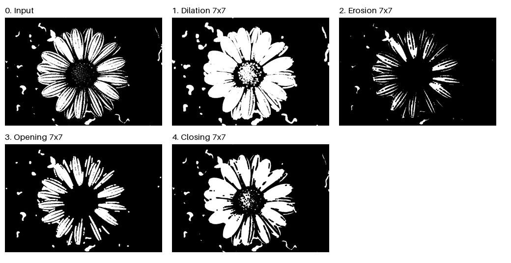

# Morphological Processing / 형태학적 이미지 처리

Apply dilation, erosion, opening and closing to a binary flower image using a 7×7 square structuring element. The operations are implemented with NumPy.

이진 꽃 이미지에 7×7 정사각형 구조 요소를 적용해 팽창·침식·열림·닫힘을 비교합니다. 각 연산은 NumPy로 구현했습니다.

## Algorithm Flow / 알고리즘 흐름

1. **Prepare the input / 입력 준비:** Composite the image onto a black background, convert to grayscale, then map values ≥128 to white and the rest to black. / 이미지를 검은 배경에 합성하고 그레이스케일로 변환한 뒤, 128 이상은 흰색, 나머지는 검은색으로 이진화합니다.
2. **Dilation / 팽창:** Take the maximum in each 7×7 neighborhood to expand white regions. / 7×7 이웃의 최댓값으로 흰 영역을 확장합니다.
3. **Erosion / 침식:** Take the minimum in each 7×7 neighborhood to shrink white regions. / 7×7 이웃의 최솟값으로 흰 영역을 축소합니다.
4. **Opening / 열림:** Apply erosion followed by dilation to remove small white noise. / 침식 후 팽창하여 작은 흰 잡음을 제거합니다.
5. **Closing / 닫힘:** Apply dilation followed by erosion to fill small black gaps. / 팽창 후 침식하여 작은 검은 틈을 메웁니다.
6. **Save / 저장:** Save the four outputs and a comparison image. / 네 결과와 비교 이미지를 저장합니다.

Code / 코드: [assignment3.py](assignment3.py)

## Results / 실행 결과



| Operation / 연산 | Result summary / 결과 요약 |
|---|---|
| [Dilation / 팽창](1_dilation.png) | White regions expand and petals become thicker. / 흰 영역이 확장되고 꽃잎이 두꺼워집니다. |
| [Erosion / 침식](2_erosion.png) | White regions shrink and thin details may disappear. / 흰 영역이 줄고 가는 부분이 사라질 수 있습니다. |
| [Opening / 열림](3_opening.png) | Small white noise is removed; some thin petal details are also reduced. / 작은 흰 잡음이 제거되고 꽃잎의 가는 부분도 일부 줄어듭니다. |
| [Closing / 닫힘](4_closing.png) | Small black gaps are filled and nearby white regions may connect. / 작은 검은 틈이 메워지고 가까운 흰 영역이 연결될 수 있습니다. |

Input / 입력: [0_binary.png](0_binary.png). Use the individual images to inspect the results at their original resolution.

원래 해상도로 결과를 확인하려면 개별 이미지를 열어봅니다.

## Run / 실행 방법

From the repository root / 저장소 루트에서 실행:

```bash
python -m pip install -r Morphological-Techniques/requirements.txt
python Morphological-Techniques/assignment3.py
```

Running the script overwrites the four result images and `5_comparison.png` in this folder.

실행하면 이 폴더의 네 결과 이미지와 `5_comparison.png`를 덮어씁니다.
