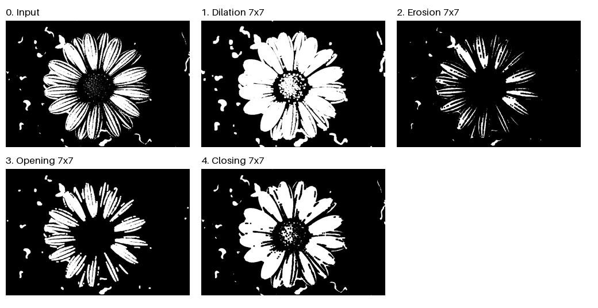
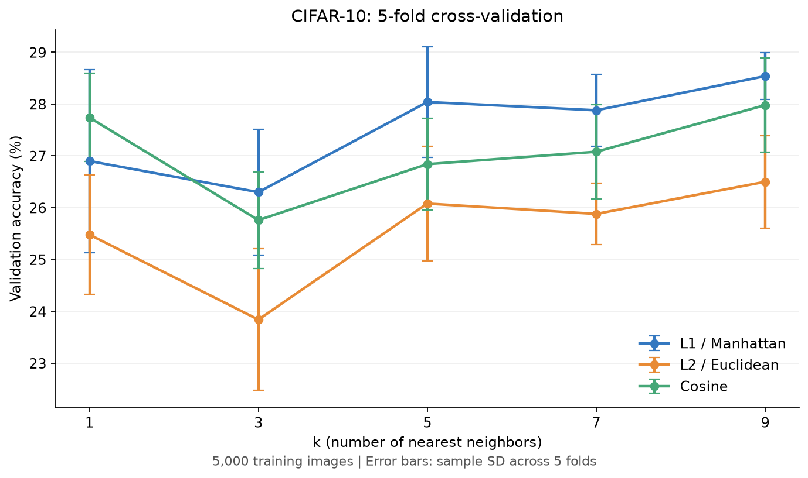

# Computer Vision Study

컴퓨터비전입문 과제의 소스 코드와 실행 결과를 정리한 저장소입니다.

| 과제 | 소스 코드 및 설명 | 실행 결과 |
|---|---|---|
| 형태학적 이미지 처리 | [assignment3](assignment3/README.md) · [Python 코드](assignment3/assignment3.py) | [입력과 네 가지 처리 결과](assignment3/5_comparison.png) |
| CIFAR-10 KNN | [assignment4](assignment4/README.md) · [Python 코드](assignment4/assignment4.py) | [결과 보고서](assignment4/results/report.md) · [교차검증 CSV](assignment4/results/cv_summary.csv) |

## 환경 설정

Python 3.10 이상을 사용합니다. 아래 명령은 저장소 루트에서 실행합니다.

```bash
python3 -m venv .venv
source .venv/bin/activate
python -m pip install -r requirements.txt
```

Windows에서는 가상환경 활성화 명령으로 `.venv\Scripts\activate`를 사용합니다.

## 1. 형태학적 이미지 처리

NumPy로 Dilation, Erosion, Opening, Closing을 구현했습니다. 모든 연산은 7×7 정사각형 구조 요소를 사용합니다. 입력 이미지와 개별 결과 이미지가 포함되어 있습니다.

```bash
python assignment3/assignment3.py
```



## 2. KNN

CIFAR-10의 원시 RGB 픽셀을 사용한 KNN 분류입니다. k=1, 3, 5, 7, 9와 L1, L2, Cosine 거리를 5-fold cross-validation으로 비교한 후, 선택한 설정을 별도 테스트 데이터에서 평가했습니다.

| 조건 또는 지표 | 저장된 결과 |
|---|---|
| 표본 수 | 학습 5,000장 / 테스트 1,000장 |
| Seed | 42 |
| 선택된 설정 | L1 (Manhattan), k=9 |
| 평균 교차검증 정확도 | 28.54% |
| 테스트 정확도 | 30.00% |

전체 CIFAR-10 데이터 실험 결과가 아닙니다. CIFAR-10 원본 데이터는 저장소에 포함하지 않았으며, [데이터 준비 및 실행 방법](assignment4/README.md)을 따라 다운로드합니다.

```bash
python assignment4/assignment4.py
```



상세 결과는 [results](assignment4/results)에 CSV, JSON, 보고서와 이미지로 포함되어 있습니다. 실행하면 수치 결과 파일을 다시 저장합니다.
