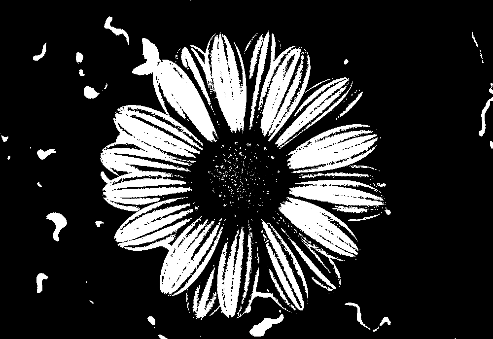
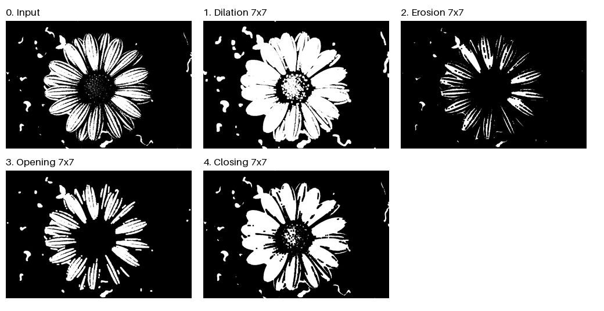

# Morphological Processing / 형태학적 이미지 처리

## Input Image / 입력 이미지

작은 잡음과 틈이 있는 이진 꽃 이미지를 사용해 각 연산의 효과를 비교합니다.

This binary flower image has small noise and gaps, so the effects are easy to see.



## Methods / 처리 방법

코드: [assignment3.py](assignment3.py). 모든 연산은 7×7 정사각형 구조 요소를 사용합니다.

Code: [assignment3.py](assignment3.py). All methods use a 7×7 square structuring element.

- **Dilation / 팽창:** Expands white regions. / 흰 영역을 확장합니다.
- **Erosion / 침식:** Shrinks white regions. / 흰 영역을 축소합니다.
- **Opening / 열림:** Erosion followed by dilation removes small white noise, but may thin the petals. / 침식 후 팽창하여 작은 흰 잡음을 제거하지만 꽃잎이 가늘어질 수 있습니다.
- **Closing / 닫힘:** Dilation followed by erosion fills small black gaps and thickens the petals. / 팽창 후 침식하여 작은 검은 틈을 메우고 꽃잎을 두껍게 만듭니다.

## How the Code Works / 코드 동작 과정

1. **Load and binarize / 입력과 이진화:** Load `0_binary.png` as RGBA, composite it onto an opaque black background, and convert it to grayscale. Values at least 128 become 255 (white foreground); all others become 0 (black background). / 입력을 RGBA로 읽어 검은 배경에 합성한 뒤 그레이스케일로 변환합니다. 128 이상은 255인 흰 전경, 나머지는 0인 검은 배경으로 이진화합니다.
2. **Create the structuring element / 구조 요소 생성:** `np.ones((7, 7))` activates all 49 positions in a centered square neighborhood. Its radius is three pixels in each axis. / 중심 기준 각 축으로 3픽셀까지 포함하는 7×7 정사각형의 49개 위치를 모두 사용합니다.
3. **Compute local extrema / 이웃 최댓값·최솟값 계산:** `dilation()` combines shifted image slices with `np.maximum`; `erosion()` combines them with `np.minimum`. These operations are implemented directly with NumPy. / `dilation()`은 이동된 영상 조각을 `np.maximum`으로, `erosion()`은 `np.minimum`으로 결합합니다. 형태학 연산을 NumPy로 직접 구현했습니다.
4. **Compose operations / 연산 조합:** `morphology_results()` applies erosion then dilation for opening, and dilation then erosion for closing. Both start from the same binary input. / `morphology_results()`에서 열림은 침식 후 팽창, 닫힘은 팽창 후 침식으로 계산합니다. 두 연산 모두 동일한 이진 입력에서 시작합니다.
5. **Save and compare / 저장과 비교:** Save four single-channel result images and a labeled comparison sheet. / 네 개의 단일 채널 결과 영상과 제목이 표시된 비교 이미지를 저장합니다.

For input $I$, pixel position $p$ and the centered symmetric square neighborhood $B$, the operations are:

입력 $I$, 픽셀 위치 $p$, 중심 대칭인 정사각형 이웃 $B$에 대해 연산은 다음과 같습니다.

$$
D_B(I)(p)=\max_{b\in B}I(p+b),\qquad E_B(I)(p)=\min_{b\in B}I(p+b)
$$

$$
O_B(I)=D_B(E_B(I)),\qquad C_B(I)=E_B(D_B(I))
$$

In a binary image, dilation makes a pixel white if any active neighbor is white; erosion keeps it white only if every active neighbor is white. Opening can remove small bright components that erosion eliminates; the following dilation cannot restore a component that disappeared entirely. Closing can fill small dark gaps by expanding the foreground before shrinking it again. Which features disappear depends on their shape and size relative to the structuring element.

이진 영상에서 팽창은 이웃 중 하나라도 흰색이면 해당 위치를 흰색으로 만들고, 침식은 이웃이 모두 흰색일 때만 흰색을 유지합니다. 열림은 침식으로 사라지는 작은 흰 성분을 제거할 수 있으며, 완전히 사라진 성분은 뒤의 팽창으로 복구되지 않습니다. 닫힘은 전경을 확장한 뒤 다시 축소해 작은 검은 틈을 메울 수 있습니다. 어떤 특징이 사라지는지는 구조 요소에 대한 특징의 모양과 크기에 따라 달라집니다.

### Boundaries and Display / 경계 처리와 표시

The primitive functions use zero padding, treating pixels outside their input array as black. `morphology_results()` first adds a three-pixel black margin, performs the operations, and crops back to the original dimensions. This retains an intermediate margin during composed operations. The documented configuration uses a 7×7 symmetric square; the helper is not presented as a general implementation for arbitrary kernels.

기본 함수는 입력 배열 바깥을 검은색으로 보는 zero padding을 사용합니다. `morphology_results()`는 먼저 검은 여백을 3픽셀 추가하고 연산한 뒤 원래 크기로 잘라냅니다. 이렇게 조합 연산 사이에 중간 여백을 유지합니다. 이 과제는 7×7 대칭 정사각형 구조 요소를 사용한 설정이며, 임의의 커널을 처리하는 범용 구현으로 설명하지 않습니다.

The individual results remain binary at the original resolution. The comparison sheet resizes previews to 320×220 using Lanczos interpolation, so preview edges may show gray values and the aspect ratio differs from the originals. Use the individual PNG files for pixel-level comparisons.

개별 결과는 원래 해상도의 이진 영상입니다. 비교 이미지는 미리보기를 Lanczos 보간으로 320×220 크기로 바꾸므로 경계에 회색 값이 생길 수 있고 원본과 종횡비가 다릅니다. 픽셀 단위 비교에는 개별 PNG 파일을 사용합니다.

## Results / 실행 결과

Individual results / 개별 결과: [Dilation](1_dilation.png) · [Erosion](2_erosion.png) · [Opening](3_opening.png) · [Closing](4_closing.png)



## Quantitative Comparison / 수치 비교

The table counts white pixels in the saved 1,000×688 images. The input is counted after the same alpha compositing and thresholding used by the script. These measurements describe foreground area, not segmentation accuracy.

저장된 1,000×688 영상의 흰 픽셀 수를 비교했습니다. 입력은 코드와 동일하게 알파 합성과 임계값 처리를 적용한 뒤 계산했습니다. 아래 값은 전경 면적이며 분할 정확도를 의미하지 않습니다.

| Image / 영상 | White pixels / 흰 픽셀 수 | Foreground ratio / 전경 비율 |
|---|---:|---:|
| Input / 입력 | 134,996 | 19.62% |
| Dilation / 팽창 | 227,338 | 33.04% |
| Erosion / 침식 | 48,389 | 7.03% |
| Opening / 열림 | 105,221 | 15.29% |
| Closing / 닫힘 | 168,627 | 24.51% |

Dilation expands the foreground and erosion reduces it. Opening leaves less foreground than the input, while closing leaves more. These changes agree with their intended effects, but area alone cannot establish whether the output preserves all desired flower details. The 7×7 element can also remove thin structures or merge nearby regions.

팽창은 전경 면적을 늘리고 침식은 줄였습니다. 열림의 전경은 입력보다 적고 닫힘의 전경은 입력보다 많았습니다. 이는 각 연산의 목적과 일치하지만, 면적만으로 꽃의 세부 구조가 모두 잘 보존됐는지는 판단할 수 없습니다. 7×7 구조 요소는 가는 구조를 제거하거나 가까운 영역을 연결할 수도 있습니다.

## Run / 실행 방법

Python 3.10 이상을 사용하고, 저장소 루트에서 실행합니다.

Use Python 3.10 or later. From the repository root:

```bash
python -m pip install -r assignment3/requirements.txt
python assignment3/assignment3.py
```

포함된 `0_binary.png`를 입력으로 사용합니다. 실행하면 이 폴더에 네 결과 이미지와 `5_comparison.png`를 저장하며 기존 결과를 덮어씁니다. NumPy로 형태학 연산을 수행하고 Pillow로 이미지를 읽고 저장하며 비교 이미지를 구성합니다.

The included `0_binary.png` is the input. The script saves the four result images and `5_comparison.png` in this folder, replacing the existing results. NumPy performs the morphological operations; Pillow loads, saves and arranges the images.
