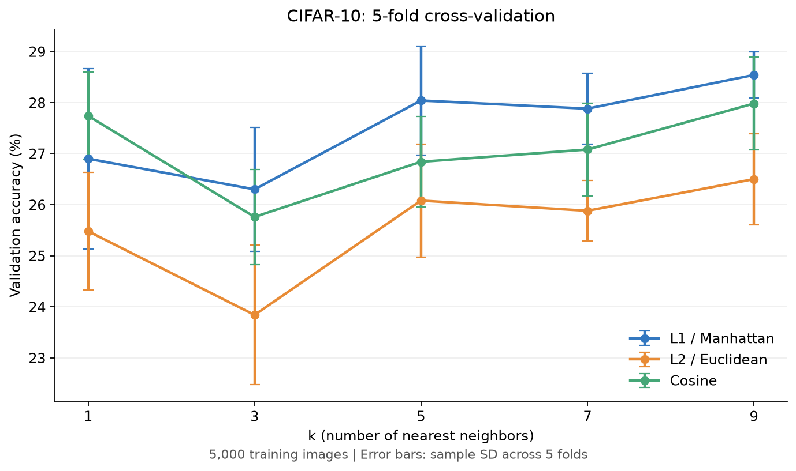

# CIFAR-10 KNN

## 데이터 준비 및 실행

Python 3.10 이상을 사용합니다. 아래 명령은 저장소 루트에서 실행합니다.

```bash
python -m pip install -r assignment4/requirements.txt
```

[CIFAR-10 공식 페이지](https://www.cs.toronto.edu/~kriz/cifar.html)의 **CIFAR-10 python version**을 다운로드해 압축을 풉니다. 원본 데이터는 저장소에 포함하지 않았습니다.

macOS/Linux에서는 다음 명령으로 준비할 수 있습니다.

```bash
curl -fL https://www.cs.toronto.edu/~kriz/cifar-10-python.tar.gz -o assignment4/cifar-10-python.tar.gz
tar -xzf assignment4/cifar-10-python.tar.gz -C assignment4
```

다음 파일들이 있어야 합니다.

```text
assignment4/cifar-10-batches-py/
├── batches.meta
├── data_batch_1
├── data_batch_2
├── data_batch_3
├── data_batch_4
├── data_batch_5
└── test_batch
```

```bash
python assignment4/assignment4.py
```

실행하면 `results/`의 수치 결과 파일을 덮어씁니다.

실험 설정은 `assignment4.py` 상단의 `TRAIN_SIZE`, `TEST_SIZE`, `K_VALUES`, `METRICS`에서 변경합니다. 기본값은 학습 5,000장·테스트 1,000장입니다. `TRAIN_SIZE`와 `TEST_SIZE`를 0으로 바꾸면 전체 데이터를 사용합니다.

## 구현

- **train**: 학습 이미지와 label을 저장합니다.
- **Distance Metric**: L1(Manhattan), L2(Euclidean), Cosine을 비교합니다.
- **predict**: 거리가 가까운 k개의 이웃을 선택하고 majority voting으로 label을 예측합니다.
- **5-fold cross-validation**: 학습 데이터를 5등분하고, 4개 fold로 train·1개 fold로 validation을 수행합니다. 5번의 평균 Accuracy로 k와 Distance Metric을 선택합니다.
- **test**: 선택한 설정만 별도 test set에서 평가합니다.

Precision·Recall·F1은 클래스별로 계산한 뒤 macro 평균합니다. 투표 동률이면 작은 label 번호를 선택합니다.

## 결과 파일

- `results/report.md`: 직접 작성한 결과 요약
- `results/cv_summary.csv`: 설정별 cross-validation 결과
- `results/result.json`: 실험 설정과 test 결과
- `results/details/`: fold별 지표, 클래스별 지표, confusion matrix 등 상세 기록

코드는 수치 결과만 저장합니다. Markdown 문서는 자동 생성하지 않으므로 실험 조건을 바꾸면 직접 수정해야 합니다.

## 저장된 결과

학습 5,000장·테스트 1,000장, seed 42에서 L1 (Manhattan), k=9가 선택됐습니다. 평균 교차검증 정확도는 28.54%, 테스트 정확도는 30.00%입니다. 전체 CIFAR-10 실험 결과가 아닙니다.



[결과 보고서](results/report.md)에서 fold별 정확도와 테스트 지표를 확인할 수 있습니다. `results/knn_2d.png`는 KNN 원리를 설명하는 2차원 예시이며, CIFAR-10의 테스트 결과를 나타내는 그림은 아닙니다.

`assignment4.py`는 수치 결과를 저장합니다. 그래프 이미지, `details/test_predictions.csv`, `details/split_indices.npz`와 결과 JSON의 추가 메타데이터는 기존 실험에서 보관한 자료로, 현재 스크립트 실행만으로 재생성되지 않습니다.
